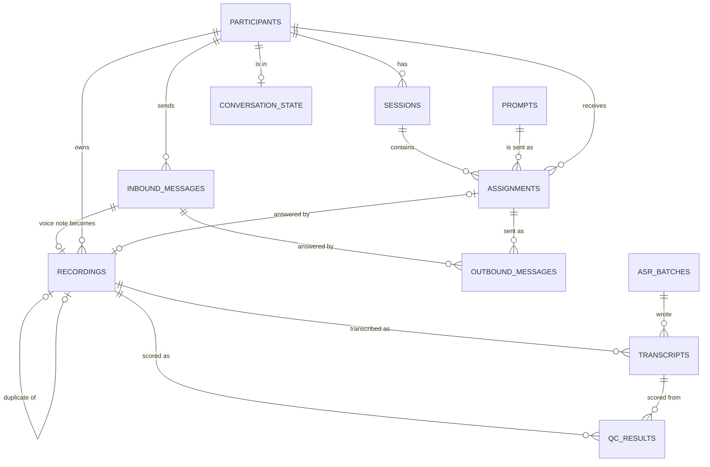

# Database schema

Last updated: 2026-11-10

Postgres is the system of record. Files (audio, prompt images) live on disk in `data/`: in the
repo locally, and on the droplet in `~/whatsapp-speech-collector/data/`, bind-mounted into the
containers at `/app/data` (audio: `AUDIO_ROOT=/app/data/audio`). The database stores paths to them,
relative to a configurable root. Schema changes are made only through Alembic migrations (`migrations/versions/`).

> This document describes the intended schema. Check it against the real one with `\d <table>`
> in psql, and update this file whenever a migration changes a table.

## Overview

| Table | Purpose | Key | Contains personal data |
|---|---|---|---|
| `inbound_messages` | Every message received from WhatsApp, raw | `message_sid` | **Yes** (phone numbers in `sender`, `raw_payload`) |
| `recordings` | One row per stored voice note | `id` (file names `R000123`) | No (participant ID only) |
| `participants` | The registry of approved contributors | `participant_id` (`P0001`) | **Yes** (name, phone number) |
| `prompts` | Sentences, conversation starters and images | `prompt_id` (`S00001`, `C0001`, `I0001`) | No |
| `sessions` | One sitting of recording by one participant | `id` | No |
| `assignments` | Every prompt sent to a participant | `id` | No |
| `conversation_state` | Where each participant is in the conversation with the bot | `participant_id` | No |
| `outbound_messages` | Every message the bot sends, and its delivery status | `id` | **Yes** (bodies can contain first names) |
| `asr_batches` | One row per run of the ASR batch (Modal transcription) | `id` | No |
| `transcripts` | Transcripts of recordings: ASR per model and run (later human) | `id` | No (recording ID only; the text is the participant's speech) |
| `qc_results` | Tier-2 quality results: metrics and a level 1-4 per scoring run per recording | `id` | No (IDs and numbers only) |
| `alembic_version` | Which migrations have been applied (managed by Alembic) | | No |

## How they connect

A voice note's journey: `inbound_messages` (raw) → `recordings` (stored audio) → linked to an
`assignments` row (which prompt it answered) → which points to `prompts` (what was asked) and
`participants` (who answered). In a `free_speech` session the assignment is an invitation to talk,
with no prompt. A recording without an assignment is an *unassigned recording*: a voice note sent
outside a session, kept but never counted toward any target.

## Tables

### inbound_messages

Every message delivered to either webhook (Twilio: `POST /whatsapp/webhook`; Meta Cloud API:
`POST /webhooks/meta`), stored before any processing. Restricted: contains phone numbers (Meta's
`wamid…` IDs embed the sender's number too).

| Column | Type | Notes |
|---|---|---|
| `id` | bigint, PK | |
| `message_sid` | text, unique | Provider message ID: Twilio `SM…`/`MM…`, Meta `wamid.…`. Deduplicates webhook retries |
| `channel` | text | `twilio` or `meta`: the webhook it arrived on. Replies go out on the same channel |
| `sender` | text | E.164 phone number |
| `message_type` | text | `text`, `audio`, `other` |
| `raw_payload` | JSONB | Twilio: the full form payload. Meta: `{"message": …, "metadata": …}` for this one message (a webhook call can carry several; contact names are dropped). Read back through the channel adapter's `parse_inbound` |
| `participant_id` | text, nullable | Set by the worker after the registry lookup |
| `status` | text | `received` → `queued` → `processed`, or `failed`, `unregistered` |
| `attempts` | int | Processing attempts |
| `error` | text, nullable | Last error |
| `received_at` | timestamptz | |
| `processed_at` | timestamptz, nullable | |
| `media_deleted_at` | timestamptz, nullable | When the media was deleted from Twilio (after storage, or without download for unregistered senders); it can't be downloaded after this. Always null for Meta |

### recordings

One row per voice note stored. Files: `<audio_root>/<participant_id>/<participant_id>_R<id>.ogg`
(original) and `.wav` (16 kHz mono, used for QC and ASR). Files never move once stored; accepted
and rejected views are produced by export.

| Column | Type | Notes |
|---|---|---|
| `id` | bigint, PK | Used in file names (`R000123`) |
| `inbound_message_id` | FK → inbound_messages, unique | One recording per message |
| `participant_id` | text, nullable | Null only for recordings made before the registry existed |
| `assignment_id` | FK → assignments, nullable | The prompt or free-speech invitation it answers. Null = an unassigned recording (sent outside a session; never counted). Failed attempts are linked too (and rejected) |
| `folder` | text | Participant folder (or `_unassigned`) |
| `original_path` | text | Relative to `audio_root` |
| `wav_path` | text | Relative to `audio_root` |
| `original_content_type` | text | Usually `audio/ogg` |
| `duration_s` | float | |
| `sample_rate`, `channels` | int | Of the WAV: 16000, 1 |
| `size_bytes` | bigint | |
| `active_seconds` | float, nullable | Seconds of the WAV with sound in it: 30 ms frames louder than −45 dBFS (`config/assignment_settings.yaml`, `clip_checks`). Measured by the worker (`src/audio/levels.py`). Null = not measured: rows from before migration `e5b9d3f7a612` until `scripts/backfill_speech_levels.py` is run, or a failed measurement (the speech check is then skipped) |
| `mean_dbfs` | float, nullable | Overall RMS level of the WAV in dBFS (0 = full scale; digital silence −120). Measured with `active_seconds` |
| `content_sha256` | text, indexed | Hash of the original audio; identical files = forwarded or re-sent |
| `duplicate_of_recording_id` | FK → recordings, nullable | Points to the earliest-received recording with the same hash |
| `provider_media_deleted` | bool | Media removed from the provider after safe storage. Twilio only: Meta keeps received media for a limited time, so nothing is deleted |
| `is_voice_note` | bool, nullable | Meta only: `true` recorded in WhatsApp, `false` an uploaded audio file. Null for Twilio, which doesn't say |
| `forwarded` | text, nullable | Meta only: `no`, `forwarded`, `frequently_forwarded`. Null for Twilio |
| `audio_origin` | text | `recorded`, `forwarded`, `uploaded` or `unknown`, from the two columns above: forwarded wins, then `is_voice_note`; Twilio rows are `unknown`. `config/assignment_settings.yaml` (`audio_origin`) decides what happens: forwarded and uploaded are rejected (`not_recorded`) except in free speech, where they are counted but flagged (`speaker_check_pending`, per-type override in `task_types.free_speech.audio_origin`); recorded and unknown are used as usual. Backfilled for older rows by migration `d8e2b5c1f9a4` |
| `status` | text | Storage status: `pending`, `stored`, `failed` |
| `error` | text, nullable | |
| `qc_status` | text, indexed | Whether the clip is usable: `pending`, `accepted`, `rejected`, `needs_review`. Rejected clips never count toward minutes; `needs_review` ones do |
| `qc_reason` | text, nullable | `too_short`, `too_long` (limits per task type and origin, config `clip_limits`), `empty`, `no_speech` (under 1.5 s of active audio, or over 30 s with under 20% active) (failed attempts, rejected, set by the conversation engine); `low_speech` (accepted but mostly silence, `needs_review`); `not_recorded` (forwarded or uploaded audio outside free speech, rejected); `speaker_check_pending` (forwarded or uploaded audio in free speech, `needs_review`; also uploads accepted in any task type before 2026-11-07; kept if the clip is also low speech). The QC step will add e.g. `duplicate`, `wrong_sentence` |
| `snr_db` | float, nullable | WADA-SNR estimate of the WAV (dB, −20 to 100), computed once by tier-2 scoring (`src/qc/metrics.py`). Null until scored, or if the WAV couldn't be read. Added by migration `b4e81c6d2a57` |
| `qc_tier2` | smallint, nullable, check 1–4 | Tier-2 level: a copy of the latest `qc_results.band` (4 usable as is … 1 probably unusable). Null = not scored (also never for unassigned recordings). Never changes `qc_status` / `qc_reason`, which are tier 1. Added by migration `b4e81c6d2a57` |
| `length_flag` | text, nullable | `long_sentence` or `long_clip`: longer than `flag_over` for its task type in `config/assignment_settings.yaml` (`clip_limits`; the default limits outside a session). Kept and counted in full; information for preprocessing (split before training), never a review flag (`qc_status` is unchanged). Null within the limit. Added by migration `f3a7c2d9e816`; older rows null (none was over 29 s) |
| `created_at`, `updated_at` | timestamptz | |

### participants

The registry, loaded from batch CSV files with `scripts/import_participants.py` and the rules in
`config/participants.yaml`. Restricted: contains names and phone numbers.

| Column | Type | Notes |
|---|---|---|
| `participant_id` | text, PK | `P0001`… from a sequence; never reused |
| `name` | text | |
| `phone_number` | text, unique | Normalized E.164 |
| `status` | text | `active`, `paused`, `completed`, `withdrawn` (`inactive` kept for older rows, treated like `paused`). STOP + confirm sets `withdrawn` |
| `is_test` | bool | Test participants are excluded from dataset exports |
| `batch` | text | The CSV's `batch` column, else `--batch` at import, else the file name without extension. Set when the participant is created; a re-import changes it only through the `batch` column |
| `enrolled_on` | date | |
| `attributes` | JSONB | Configurable fields (`config/participants.yaml`): `age`, `sex`, `district`, `first_language`, `accent`, and the optional primary recording device from registration: `primary_device_type` (`phone`, `tablet`, `computer`), `primary_device_brand`, `primary_device_model`. Also an optional `targets_minutes` override: `{"per_participant": 6}` (split as in `config/assignment_settings.yaml`, each type rounded to 0.5 min) or explicit per-type minutes, e.g. `{"sentence": 2, "image": 1, "conversation_starter": 1}` (types left out keep the default). The total shown to the participant is always the sum of the per-type targets |
| `created_at`, `updated_at` | timestamptz | |

### prompts

Everything a participant can be asked to respond to, loaded with `scripts/import_prompts.py`
(rules in `config/prompts.yaml`).

| Column | Type | Notes |
|---|---|---|
| `id` | bigint, PK | |
| `prompt_id` | text, unique | `S00001` sentence, `C0001` conversation starter, `I0001` image; one sequence per type |
| `prompt_type` | text | `sentence`, `conversation_starter`, `image` |
| `text` | text, nullable | The sentence or question; empty for images |
| `normalized_text` | text | For duplicate detection (unique per type) |
| `source` | text | Where it came from, e.g. a DHS questionnaire, `synthetic-english-test`, `ai-generated` |
| `domain` | text, nullable | Topic; for images, the subfolder name |
| `media_path` | text, nullable | Images: prepared JPEG, relative to `prompt_media_root` (`<domain>/I0001.jpg`) |
| `media_content_type` | text, nullable | `image/jpeg` |
| `media_size_bytes`, `media_width`, `media_height` | bigint/int, nullable | Of the prepared copy |
| `content_sha256` | text, nullable | Images: hash of the original as supplied (unique per type; duplicates detected on it) |
| `attributes` | JSONB | Optional columns (license, notes); images: `batch`, `original_name` |
| `flags` | JSONB | e.g. `{"length": "short"}`, `{"joined_lines": true}`, `{"all_caps": true}` |
| `source_file` | text | Batch file or folder it was imported from |
| `active` | bool | Inactive prompts are never assigned but keep their history |
| `created_at` | timestamptz | |

### sessions

One sitting: a participant recording one task type, up to `session_size` prompts, ending early
when that type's target is met.

| Column | Type | Notes |
|---|---|---|
| `id` | bigint, PK | |
| `participant_id` | FK → participants | At most one active session per participant |
| `task_type` | text | A type from `task_types` in `config/assignment_settings.yaml`: `sentence`, `image`, `conversation_starter`, `free_speech` |
| `status` | text | `active`, `completed`, `paused`, `abandoned` |
| `size` | int | Planned number of prompts |
| `started_at`, `ended_at` | timestamptz | |

### assignments

Every time a prompt is sent to someone. Drives coverage (how many speakers each prompt has) and
links each recording to what was asked. Unprompted types (`free_speech`) have a row per invitation
to talk, with no prompt (`prompt_id` null) and no coverage; everything else (session position,
expiry, retakes, minutes) works the same.

| Column | Type | Notes |
|---|---|---|
| `id` | bigint, PK | |
| `participant_id` | FK → participants | Unique with `prompt_id`: nobody gets the same prompt twice |
| `prompt_id` | FK → prompts, nullable | Null for unprompted types (`free_speech`) |
| `prompt_type` | text | The task type, including `free_speech` |
| `session_id` | FK → sessions | Unique with `position` |
| `position` | int | 1…session size ("Sentence 4 of 10") |
| `prompt_text_snapshot` | text, nullable | Exactly what was sent; the reference text for the faithfulness check |
| `status` | text | `sent` → `recorded` → `accepted` / `rejected`, or `expired`, `skipped` |
| `outbound_message_sid` | text, indexed | Provider ID of the message carrying the prompt (Twilio SID or Meta wamid); matches swipe-replies, but only from the same channel (checked against `outbound_messages.channel` and `provider_message_id`) |
| `retake_count` | int | |
| `sent_at`, `expires_at`, `answered_at` | timestamptz | Unanswered assignments expire after `assignment_expiry_hours` |
| `recording_id` | FK → recordings, nullable | The newest recording that answered it and wasn't rejected (failed attempts link to the assignment but don't replace this) |
| `message_variant` | int, nullable | Which caption/wrapper variant was used when the prompt was sent (index into the catalog list, e.g. `prompt.image_caption`) |

Coverage of a prompt = its accepted + recorded + unexpired sent assignments; it stops being
assigned at `speakers_per_prompt` (see `config/assignment_settings.yaml`).

### conversation_state

Where each participant is in the conversation. One row per participant, created on their first
message. Read and written by the conversation engine (`src/conversation/engine.py`) under a
per-sender advisory lock, in the same transaction as the reply's `outbound_messages` rows.

- After more than `fresh_start_after_hours` (config/assignment_settings.yaml) without a message from
  the participant, a non-idle state goes back to `idle`: the active session is paused and its
  unanswered prompts expire. A voice note swiped onto a prompt that hasn't expired is the exception.
- If a reply is never delivered (`outbound_messages.status` `failed` or `skipped_window`), the state
  goes back to what it was before that turn (`outbound_messages.state_snapshot`), under the same
  lock, unless a later turn has changed it since. Recordings and answers are kept.

| Column | Type | Notes |
|---|---|---|
| `participant_id` | FK → participants, PK | |
| `state` | text | `idle`, `awaiting_ready`, `in_session`, `awaiting_continue`, `awaiting_stop_confirm` |
| `context` | JSONB | e.g. `offered_task_type`, `previous_state` (to return to after a cancelled STOP), `welcomed`, `instructions_seen` (`general` and one per task type), `session_id` |
| `updated_at` | timestamptz | |

### outbound_messages

Every message the bot sends. Written together with the state change it belongs to, then sent by
the `send_outbound` job (RQ queue `outbound`). Restricted: bodies can contain first names. The
recipient's number isn't stored here; it comes from the inbound message being answered.

| Column | Type | Notes |
|---|---|---|
| `id` | bigint, PK | |
| `participant_id` | FK → participants, nullable | Null for replies to unregistered numbers |
| `inbound_message_id` | FK → inbound_messages | The message being answered. Unique with `purpose`: a retried job never sends the same reply twice |
| `purpose` | text | `reply`; `reply_media` when an image prompt's caption is too long and the text goes first; `template:<name>` for a template message (e.g. `template:registration_welcome`), which answers nothing: no `inbound_message_id`, sent to the registered number, exempt from the 24-hour check; its template, language and values are in `message_keys` |
| `sequence` | int | Order within one turn; each message sent queues the next |
| `message_keys` | JSONB | Catalog keys used, with variant indexes: `[{"key": "prompt.image_caption", "variant": 2}, …]` |
| `body` | text | Exactly what was sent (or the image caption) |
| `media_prompt_id` | FK → prompts, nullable | Image prompts: sent as media via a signed `/media/prompts/{token}` URL |
| `assignment_id` | FK → assignments, nullable | The prompt this message carries; marked sent with the provider message ID |
| `status` | text | `pending` → `sent` → `delivered` → `read`, or `failed` (Twilio: status callbacks to `POST /whatsapp/status`; Meta: `statuses` in `POST /webhooks/meta`), or `skipped_window`: not sent because the participant's last message on this channel is older than `reply_window_hours` (default 23.5), or refused for that reason (Meta 131047, Twilio 63016). Neither `failed` nor `skipped_window` is retried once set, and the rest of the same reply gets the same status |
| `channel` | text | `twilio` or `meta`: the channel of the inbound message being answered, and the one it is sent on |
| `provider_message_id` | text, nullable | Twilio SID or Meta wamid once sent. Unique with `channel` |
| `error`, `error_code` | text, int, nullable | The provider's error, e.g. Twilio 63019 when it couldn't fetch an image, Meta 131047 outside the 24-hour window |
| `error_details` | JSONB, nullable | The provider's error fields: Meta `code`, `subcode`, `type`, `title`, `message`, `details`, `fbtrace_id`, `http_status`; Twilio `code`, `message`, `http_status`. URLs and phone numbers are replaced; never tokens or message text |
| `state_snapshot` | JSONB, nullable | `{"before": {"state", "context"}, "after": {...}}` for the turn that wrote this reply; used to roll the conversation back if the reply isn't delivered. Null for unregistered senders |
| `created_at`, `sent_at`, `status_updated_at` | timestamptz | |

### asr_batches

One row per run of `scripts/asr_batch.py` (migration `9698f26aa068`). Settings in
`config/asr_batch.yaml`; raw results in `data/asr_batches/<id>/results.jsonl`.

| Column | Type | Notes |
|---|---|---|
| `id` | bigint, PK | Also the results folder name |
| `started_at`, `finished_at` | timestamptz | `started_at` is indexed (the once-per-slot check) |
| `status` | text | `running`, then `completed` (nothing failed), `partial` (some clips failed), `failed` (none transcribed, or Modal unreachable) or `interrupted` (stopped, or found still `running` by the next batch) |
| `trigger` | text | `scheduled` (cron, `--scheduled`) or `manual` |
| `model_key` | text | `whisper_b` or `whisper_v1` (`scripts/modal_asr_app.py`) |
| `model_repo`, `model_revision` | text, nullable | As Modal reported them: the Hugging Face repo and its resolved commit SHA |
| `filters` | JSONB | The options used: `since`, `until`, `participants`, `recording_ids`, `include_test`, `force`, `limit` (only those set) |
| `clips_selected` | int | Sent to Modal |
| `clips_transcribed`, `clips_failed` | int | Updated after each chunk. Failed clips get no transcript and are retried by the next batch |
| `clips_missing` | int | Selected but the WAV file wasn't on disk (not sent; IDs in the log) |
| `audio_seconds` | float | Audio transcribed |
| `gpu` | text, nullable | e.g. `NVIDIA L4` |
| `error` | text, nullable | Why the batch failed or stopped |

### transcripts

Several per recording over time: one per ASR model and run, later human transcripts. A forced
re-run adds a row; the latest per source and model is by `created_at`, then `id`. Unique on
(`id`, `recording_id`) (added by `b4e81c6d2a57`), which `qc_results` references so a result can
only pair a recording with its own transcript.

| Column | Type | Notes |
|---|---|---|
| `id` | bigint, PK | |
| `recording_id` | FK → recordings | Index on (`recording_id`, `source`, `model_key`) |
| `source` | text | `asr` (written by the ASR batch); `human` and `prompt` later |
| `model_key`, `model_repo`, `model_revision` | text, nullable | ASR only: the model key, Hugging Face repo and commit SHA |
| `text` | text | As the model returned it (stripped, not normalised). Can be empty |
| `avg_logprob` | float, nullable | Mean log-probability of the generated tokens (ASR only) |
| `long_form` | bool, nullable | ASR only: true if decoded with Whisper long-form generation (audio over 30 s, from 2026-11-08), false for 30 s or less. Null for rows from before the Modal app reported it, and for other sources. Added by migration `f3a7c2d9e816` |
| `batch_id` | FK → asr_batches, nullable, indexed | The batch that wrote it |
| `created_at` | timestamptz | |

### qc_results

Tier-2 quality checks (ASR batch step 2, `src/qc/`; design in `docs/methodology.md` section 8).
One row per scoring run per recording: rows are only added, never updated or deleted by the
scorer, so re-scoring with new cut-offs keeps the old rows for comparison. The latest per
recording is by `created_at`, then `id` (both descending), and its `band` is copied to
`recordings.qc_tier2`. Audio facts that don't change (`duration_s`, `active_seconds`, `mean_dbfs`,
`snr_db`) are read from `recordings` and `avg_logprob` from the transcript; they are not copied
here. Added by migration `b4e81c6d2a57`.

| Column | Type | Notes |
|---|---|---|
| `id` | bigint, PK | |
| `recording_id` | bigint, FK → recordings (ON DELETE RESTRICT) | A recording with results can't be deleted. Index on (`recording_id`, `created_at`, `id`) |
| `transcript_id` | bigint | The transcript scored (the configured model's latest). Composite FK (`transcript_id`, `recording_id`) → transcripts (`id`, `recording_id`), ON DELETE RESTRICT: never another recording's transcript |
| `stage` | text, default `asr` | |
| `word_count` | int | Words in the normalised transcript |
| `words_per_second` | float, nullable | `word_count` ÷ `active_seconds`; null if `active_seconds` is null or 0 |
| `compression_ratio` | float, nullable | UTF-8 bytes ÷ zlib-compressed bytes of the transcript (as Whisper computes it); null if empty |
| `cer`, `wer` | float, nullable | Sentences only: normalised transcript vs normalised `assignments.prompt_text_snapshot` (jiwer) |
| `length_ratio` | float, nullable | Sentences only: normalised transcript characters ÷ normalised prompt characters |
| `has_digits` | bool, nullable | Sentences only: the prompt text contains a digit (CER unreliable; level capped at 2) |
| `band` | smallint, check 1–4 | The level, by the weakest link (`config/qc_tier2.yaml`) |
| `band_reason` | text | The metric(s) at the lowest level, e.g. `cer:2`, `compression_ratio:1,word_count:1`; `all_ok` for 4 |
| `metrics_version` | text | How the metrics were computed (`1`) |
| `thresholds_version` | text | The cut-offs used (e.g. `2026-11-10-provisional`) |
| `created_at` | timestamptz | |

## Files on disk

| Path | Contents |
|---|---|
| `data/participants/` | Participant batch CSVs (real names and numbers; never in git) |
| `data/prompts/text/`, `data/prompts/conversation-starters/` | Prompt batch CSVs, `*_imported.csv` copies with IDs, `*_rejected.csv` |
| `data/prompts/images/<batch>/<domain>/` | Original images |
| `data/prompts/images/_prepared/<domain>/I0001.jpg` | WhatsApp-ready copies: JPEG, metadata stripped, resized |
| `data/audio/<participant_id>/` | Original `.ogg` and 16 kHz `.wav` per recording |
| `data/asr_batches/<batch_id>/results.jsonl` | Raw output from Modal per ASR batch (recording IDs and transcripts); `cron.log` on the droplet |
| `data/qc/tier2-sample-<thresholds_version>.csv` | Tier-2 listening samples (`scripts/score_tier2.py --sample N`): recording, participant and prompt IDs, level, metrics, WAV path; no names or transcripts |
| `config/` | Import rules, assignment settings, ASR batch and tier-2 cut-offs (`qc_tier2.yaml`) (YAML) |
| `messages/bot_messages_en.yaml` | Bot message texts (Chichewa version later) |

All of `data/` is gitignored.
