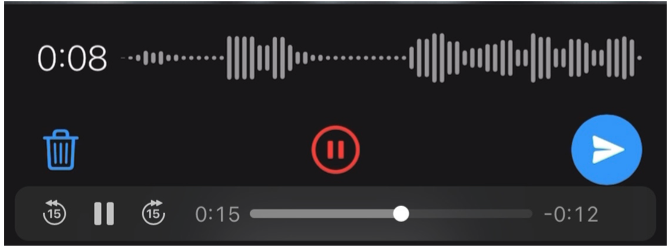
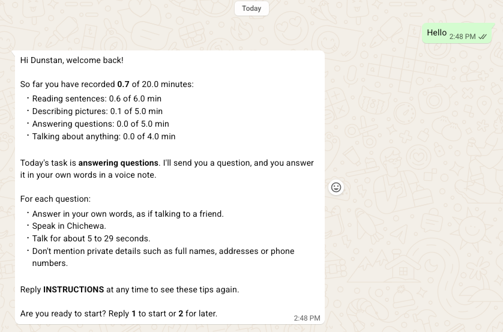

# Contributor onboarding manual

Converted on 2026-11-13 from `contributor-onboarding-manual-v1.docx`. The supplied Word source is retained in `sources/`. Content is preserved; only Markdown formatting has been normalized.

Original title: **Chichewa Speech Project — Contributor Onboarding Guide**.

The source still contains a form-link placeholder and an incomplete contact-list item. These remain pending coordinator review.

## Project Background

### Project Objectives

The project aims to collect 500 hours of Chichewa speech to support the development and evaluation of speech-to-text (STT) technology, which turns spoken words into written text, and text-to-speech (TTS) technology, which turns written text into spoken audio. It is supported through a Masakhane grant and implemented by ZaZo AI Ltd., a Malawi-based technology company specialising in developing and improving AI for Chichewa and other local languages.

The project objectives are to collect clear recordings of both read and spontaneous speech; represent different Chichewa accents, dialects and speaker backgrounds; and prepare a speech dataset that researchers and developers can use to improve Chichewa speech technology.

The dataset will be publicly released. Before deciding to contribute, read the consent form and privacy notice to understand how your recordings will be shared and how others may reuse them.

### How Participation Works

Adult Chichewa-speaking Malawians in Malawi or abroad can contribute audio recordings through Tiyankhuleni, the project’s WhatsApp recording assistant, at +1 618-602-0282. Starting in November 2026, speech collection will take place on a rolling basis through a series of recording rounds, with a new group of contributors invited to participate in each round.

### How Will My Speech Be Used

The recordings will form part of a publicly available Chichewa speech dataset to support the development and evaluation of speech-to-text and text-to-speech technology. The dataset will include recordings and selected demographic and language information, but will exclude contributors’ names and phone numbers.

## Roles and Responsibilities

The project brings together people in several roles, including maintaining the Tiyankhuleni WhatsApp recording assistant, coordinating project activities, recruiting contributors, supervising recording rounds and contributing speech recordings. The following sections focus on your role as a speech contributor and the role of your supervisor, who will work directly with you throughout your participation.

### Role of the Speech Contributor

Contribute your own voice by reading sentences, describing pictures, answering questions and speaking about everyday topics. Contributors are carefully selected to represent different ages, sexes, Chichewa dialects and accents, including Chichewa spoken with influences from languages such as Chiyao and Chitumbuka. Your natural way of speaking is therefore an important part of your contribution. Speak as you normally would, without acting, imitating a broadcaster or changing your accent or dialect.

- **Complete the intake and consent form.** Complete the form before recording, provide accurate information and use your registered WhatsApp number.

- **Review this guide.** Read the guide before you begin and ask your supervisor about anything that is unclear.

- **Submit recordings that meet the guidelines.** Follow the recording requirements and submit only your own recorded speech.

- **Complete recordings within the agreed period.** Submit the required amount of accepted speech within the recording period communicated by the assigned supervisor. Each recording round has a target of **accepted audio** per contributor, between **20 and 60 minutes**.

- **Follow your supervisor’s guidance and feedback.** Apply recording tips and submit additional recordings when needed to complete your accepted speech target.

- **Report challenges and problems.** Inform your supervisor about technical difficulties or other issues that affect your participation.

### Role of the Supervisor

Each contributor is assigned a supervisor who provides support throughout the recording round. The supervisor assists with registration and recording, reviews recording quality, explains feedback and confirms when the contribution is complete. Supervisors may contact contributors through WhatsApp or phone and are available to clarify instructions and address questions.

- **Track recording progress.** Monitor each contributor’s progress towards their accepted speech target.

- **Check recording quality.** Review submitted recordings and provide feedback to help contributors meet the recording requirements.

- **Coordinate honorarium and internet bundle support.** Coordinate the provision of data bundle funds and honorarium payments.

- **Resolve issues.** Help contributors address technical difficulties and other challenges throughout their participation.

## Honorarium and Internet Bundle Support

Each recording round has an accepted audio target of between 20 and 60 minutes per contributor. The assigned supervisor will confirm your target before recording begins.Only accepted recordings count towards the target.

The honorarium is paid at a rate of **MK700 per minute of accepted audio.**

**Table-1: Honorarium and Internet Bundle Support by Accepted Audio Target**

<table style="width:99%;">
<colgroup>
<col style="width: 23%" />
<col style="width: 19%" />
<col style="width: 22%" />
<col style="width: 33%" />
</colgroup>
<thead>
<tr>
<th style="text-align: left;">
<strong>Target</strong>

<strong>(accepted audio)</strong>
</th>
<th style="text-align: left;"><strong>Honorarium</strong></th>
<th style="text-align: left;"><strong>Internet bundle support</strong></th>
<th style="text-align: left;"><strong>Bundle instalments</strong></th>
</tr>
<tr>
<th style="text-align: left;">20 minutes</th>
<th style="text-align: left;">MK14,000</th>
<th style="text-align: left;">MK6,500</th>
<th style="text-align: left;">TBD</th>
</tr>
<tr>
<th style="text-align: left;">30 minutes</th>
<th style="text-align: left;">MK21,000</th>
<th>MK6,500</th>
<th style="text-align: left;">TBD</th>
</tr>
<tr>
<th style="text-align: left;">45 minutes</th>
<th style="text-align: left;">MK22,500</th>
<th>MK6,500</th>
<th style="text-align: left;">TBD</th>
</tr>
<tr>
<th style="text-align: left;">60 minutes</th>
<th style="text-align: left;">MK42,000</th>
<th>MK6,500</th>
<th style="text-align: left;">TBD</th>
</tr>
</thead>
<tbody>
</tbody>
</table>

Honorarium and internet bundle support depend on the agreed target, as shown in the table above. Internet bundle support is paid in two equal instalments: 50% at the start of the recording round and 50% once half of the accepted speech target has been met.

The assigned supervisor will review the recordings, confirm that the agreed target has been met and approve the honorarium, with payment expected within **1–2 weeks of submitting the complete contribution.** All payments are made through **Airtel Money or TNM** Mpamba using the contributor’s registered mobile money number.

## Consent and Contributor Registration

As part of onboarding, you will receive a Google Form called the *Contributor Intake and Consent Form.* The first part asks for your consent to collect, use and share your contribution as described below.

**What you are consenting to:**

- The use of your recordings to develop and evaluate speech technology, including speech-to-text and text-to-speech models.

- The collection of basic demographic and language information: your age group, sex, district, first language and Chichewa dialect.

- The public release of your recordings and this demographic and language information under the [<u>Creative Commons Attribution 4.0 International (CC BY 4.0)</u>](https://creativecommons.org/licenses/by/4.0/), allowing others to access and reuse them under its terms.

**What will remain confidential:**

Your name and phone number are collected for project communication, registration and payment administration. They will be kept confidential and excluded from the public dataset. Only your recordings and the demographic and language information you agree to share will be publicly released.

Someone who knows you may still recognise your voice. Read the consent information carefully and ask the assigned supervisor about anything that is unclear before agreeing to participate.

### Complete Intake and Consent Form

1.  **Read the consent information and privacy notice.** Ask the assigned supervisor to explain anything you do not understand.

2.  **Sign to confirm your consent.** If you agree to participate, sign the consent section of the Contributor Intake and Consent Form.

3.  **Provide accurate contributor information.** Complete the remaining fields carefully, including your name, WhatsApp number, age group, sex, district, first language, Chichewa dialect and accent, and phone details.

4.  **Review and submit the form.** Check that all required fields are complete and accurate before submitting: \[CONFIRM: form link\].

5.  **Wait for registration confirmation.** The assigned supervisor will confirm that your form is complete and your WhatsApp number is registered before you begin recording.

### How Your Recordings and Information Will Be Used

With your consent, your recordings and selected demographic and language information will be published as part of a Chichewa speech dataset to support speech technology. Your name and phone number will remain confidential and will not appear in the public dataset.

Consent is provided through the Contributor Intake and Consent Google Form. Before agreeing, read the [<u>consent statement</u>](https://docs.google.com/document/d/1n2zFnu8W2Evh3-7tNEQw1hdGPV0VYfPfM1xbDQBMUTU/edit?usp=sharing), which you can also download for your records, and the [<u>Data Privacy and Protection Policy</u>](https://docs.google.com/document/d/1F6wA0p561TIForG2CC5V-yfFCf89TU9MmTJnbRVBMWE/edit?usp=share_link), which explains how your information is handled and protected throughout the project.

## WhatsApp Recording Guide

### General Recording Guidelines

- **Privacy and confidentiality:** Avoid names, phone numbers, addresses and sensitive information about yourself or others. Only share information you are comfortable making public.

- **Natural Chichewa.** Use your usual voice, accent and dialect. In free speech, picture descriptions and question responses, a few English words are acceptable, but speak mainly in Chichewa. Read written sentences exactly as provided.

- **Clear audio.** Record somewhere quiet, away from music, wind and other conversations. Speak clearly at a normal volume without whispering or shouting.

- **Your own recordings.** Submit only your own voice. Record a new response for each sentence, picture or conversation prompt. For free speech, you may use an earlier recording of your own voice if it meets the requirements in **Table 1**.

- **Recording duration.** Every voice note must be at least **5 seconds** long. Maximum lengths vary by task; see **“How Long to Record”** under Getting Started with WhatsApp.

- **Your recording target.** Each recording round has a target of **accepted audio** per contributor, between **20 and 60 minutes**. Your supervisor tells you your target before recording begins, and Tiyankhuleni shows your progress towards it (send **PROGRESS** at any time). Only accepted recordings count, so plan to record a little more than your target.

### Getting Started on WhatsApp

#### Setting Up WhatsApp

1.  **Confirm registration.** Complete the Contributor Intake and Consent Form and wait for confirmation that your WhatsApp number is registered.

2.  **Save the project number.** Save **+1 618-602-0282** as **Tiyankhuleni** in your phone contacts.

3.  **Start the chat.** Open the WhatsApp chat with Tiyankhuleni and send “Hi”. Follow the instructions to choose a recording task.

#### Recording and Reviewing a Voice Note

The appearance and availability of recording controls may vary by device and WhatsApp version.

1.  **Prepare your response.** Read the sentence or topic prompt, or study the picture. Find a quiet place and hold your phone 15–20 cm from your mouth.

2.  **Start recording.** Press and hold the microphone, then slide upwards to lock recording. You can now lift your finger.

3.  **Speak naturally.** Wait about one second before speaking.

4.  **Pause and listen.** Tap Pause, then Play to listen before sending. Check that your voice is clear and your full response has been captured.

5.  **Re-record if needed.** Tap the trash icon to discard before sending, then repeat the recording process.

6.  **Send when ready.** Tap the Send arrow when satisfied. Wait for Tiyankhuleni’s reply before continuing.

#### How long to record

- Every voice note must be **at least 5 seconds** long.

- **Sentences:** read the whole sentence at your normal pace. Don’t rush, skip words or stop early. Most sentences take well under 30 seconds. If a reading goes over **45 seconds**, the bot asks you to try again.

- **Pictures, questions and free speech:** aim for **15 to 30 seconds**, enough to say two or three clear points. You can go up to **1 minute**, so finish your thought rather than stopping mid-sentence.

- **Older voice notes (free speech only):** You may attach or forward previously recorded voice notes of your own voice, up to **2 minutes** long, provided they meet the requirements in **Table 2.**

- If a voice note is too short or too long, the bot tells you and asks you to record again.

### The Four Recording Tasks

#### A. Reading Sentences

Read the complete sentence exactly as written, at a natural pace. Do not add greetings or comments, change words or translate the sentence.

Good: Read every written word, using your usual accent. Pause naturally at punctuation. Avoid: Replacing a word with a synonym; saying “the sentence is…” before reading; or skipping a difficult word. Ask your supervisor about unclear text.

#### B. Describing Pictures

Look carefully before recording. Describe the main people, objects and actions that are clearly visible. Use enough detail for someone who cannot see the picture to understand it.

Good: Describe a person carrying a basket, or explain where objects are placed. Avoid: Listing only one or two words, inventing someone’s name or history, or describing events that are not visible.

#### C. Conversation Starters and Questions

Read the prompt and speak about the topic in your own words, as if talking to someone you know. Share relevant details, experiences or opinions. If the prompt asks a question, answer it and explain your response. Do not read the prompt aloud.

**Good:** For a prompt about cooking, describe how you prepare a meal. For a prompt about transport, explain how you usually travel and why.

**Avoid:** Giving only a one-word answer, repeating the prompt or talking about an unrelated topic.

#### D. Free Speech

Choose a different topic for each voice note where possible. Draw on different parts of everyday life, such as family, friendships, relationships, food, farming, travel, school, work, sport, traditions, weather or technology. You can describe an experience, explain how something is done or share an opinion. Speak naturally in your own words, express one clear idea per recording and stay within the time limit.

**Good:** Describe a family tradition in one recording, a journey in the next and what makes a good friendship in another. Your topics do not need to be unusual or complicated.

**Avoid:** Repeating the same story across recordings, reading a prepared passage, playing someone else’s voice or sharing names and sensitive details about yourself or others.

**Table-2:** **Using previously recorded Voice Notes or audio files**

<table>
<colgroup>
<col style="width: 100%" />
</colgroup>
<thead>
<tr>
<th>
<strong>For free speech only: using voice notes or audio files you recorded before</strong> 
You may send (attach or forward) a voice note or audio file you recorded earlier, for example one you sent to a friend or family member, if all of these are true:

<ul>
<li>
Only your own voice is in it, with no one else speaking, singing or playing music in the background;
</li>
<li>
It is 5 seconds to 2 minutes long;
</li>
<li>
You are comfortable with it becoming part of a public dataset, and it does not mention names, phone numbers, places or private matters about you or anyone else.
</li>
</ul>

Older voice notes or audio files are accepted for <strong>free speech only</strong>. For sentences, pictures and questions, always record a new voice note.
</th>
</tr>
</thead>
<tbody>
</tbody>
</table>

### Sessions, Breaks and Replacing a Recording

A session is a short set of prompts of one task type, for example up to 10 sentences. Tiyankhuleni sends one prompt at a time. Answer each with a voice note and wait for Tiyankhuleni’s reply before sending the next one.

When you send Hi, Tiyankhuleni shows your progress and the next task, and asks whether you want to start now or later. At the end of a session it shows your progress again and offers the next task.

You can stop at any time. If you come back within 24 hours, you continue where you left off. After more than 24 hours, Tiyankhuleni starts again with a welcome-back message and new prompts.

To replace a recording: swipe right on Tiyankhuleni’s prompt to reply to it, then record a new voice note. Tiyankhuleni uses the new one. Deleting a voice note in WhatsApp does not remove it, because Tiyankhuleni is not told about deletions.

### Quality Checks and Feedback

#### Instant Checks

Tiyankhuleni checks every voice note as soon as it arrives. It asks you to record again if the clip is:

- shorter than 5 seconds, or longer than the limit for the task (45 seconds for sentences, 1 minute for pictures, questions and free speech, 2 minutes for older voice notes)

- silent, or almost silent;

- a copy of a voice note you already sent.

#### What Counts Towards Your Target

For sentences, pictures and questions, only voice notes you record in WhatsApp for that prompt count. Forwarded voice notes and attached audio files are not accepted, and Tiyankhuleni asks for a new recording. For free speech, an older voice note of your own may be used (see “Using Voice Notes You Recorded Before”).

#### Later Checks and the Daily Report

After you record, every clip is transcribed automatically, and read sentences are compared with the text. Supervisors listen to clips that were flagged and to a random sample of others. The results go into a daily report, so a clip Tiyankhuleni accepted earlier may still be removed later.

#### What Makes a Recording Unusable

- Unclear speech, or too much background noise.

- Cut off at the start or end.

- The wrong sentence, or not following the task.

- Not in Chichewa.

- Someone else’s voice, or more than one person speaking.

- Names or private details about you or others.

#### If a Recording Is Removed After Review

When the later checks or a supervisor remove a clip that Tiyankhuleni had accepted, Tiyankhuleni replies to that voice note with the reason and a tip. The clip then no longer counts towards your target. Just continue with the new tasks Tiyankhuleni gives you; you never need to repeat the removed prompt. If the review results arrive more than 24 hours after your last message, you’ll first get a short notice asking you to reply. Your supervisor may also contact you.

### Common Questions and Troubleshooting

- **Tiyankhuleni does not reply.** Check your internet connection and that you are messaging +1 618-602-0282, send “Hi” again and wait about a minute. If it still does not reply, contact your supervisor.

- **Tiyankhuleni says “not registered”.** Make sure you are using the WhatsApp number you gave on your intake form. If it is the right number, ask your supervisor to check your registration.

- **I sent the wrong voice note.** Swipe right on Tiyankhuleni’s prompt, then record a new voice note. Tiyankhuleni uses the new one.

- **A clip was rejected.** Read Tiyankhuleni’s reason and record again. Most rejections are clips that are too short, too long or silent. For noise or cut-off speech, move somewhere quieter and pause for a second before and after speaking.

- **I don’t know how much I have left.** Send “progress”: Tiyankhuleni shows your progress. Your supervisor can confirm your accepted minutes.

- **I don’t understand the instructions.** Ask your supervisor.

- **Can I take a break?** Yes. Within 24 hours you continue where you left off; after that, Tiyankhuleni welcomes you back with new prompts. Finish within your agreed collection period, or tell your supervisor if you need more time.

- **I changed my phone number.** Tell your supervisor before you continue. Tiyankhuleni will not recognise the new number until your registration is updated.

- **When is my honorarium paid?** After all your recordings have been checked and your accepted minutes are confirmed, as described in Section 3.

## Project Contacts

If the assigned supervisor is unavailable, contact the following project team members through WhatsApp:

1.  **Evance Mathewe-+265 888 72 15 91:** Recording coordination, honorarium payments and internet bundle support.

2.  **Tiyankhuleni Assistant, consent form. Stewart Chikomola. +265 999 10 17 14**

3.  

4.  **Chikoko Banda-+265 994 41 51 74:** Recording coordination, honorarium payments and internet bundle support.

5.  **Stewart Chikomola -+265 999 10 17 14:** Tiyankhuleni registration and technical issues.

6.  **Dunstan Matekenya-+1 202 294 8588:** Other questions or concerns.
